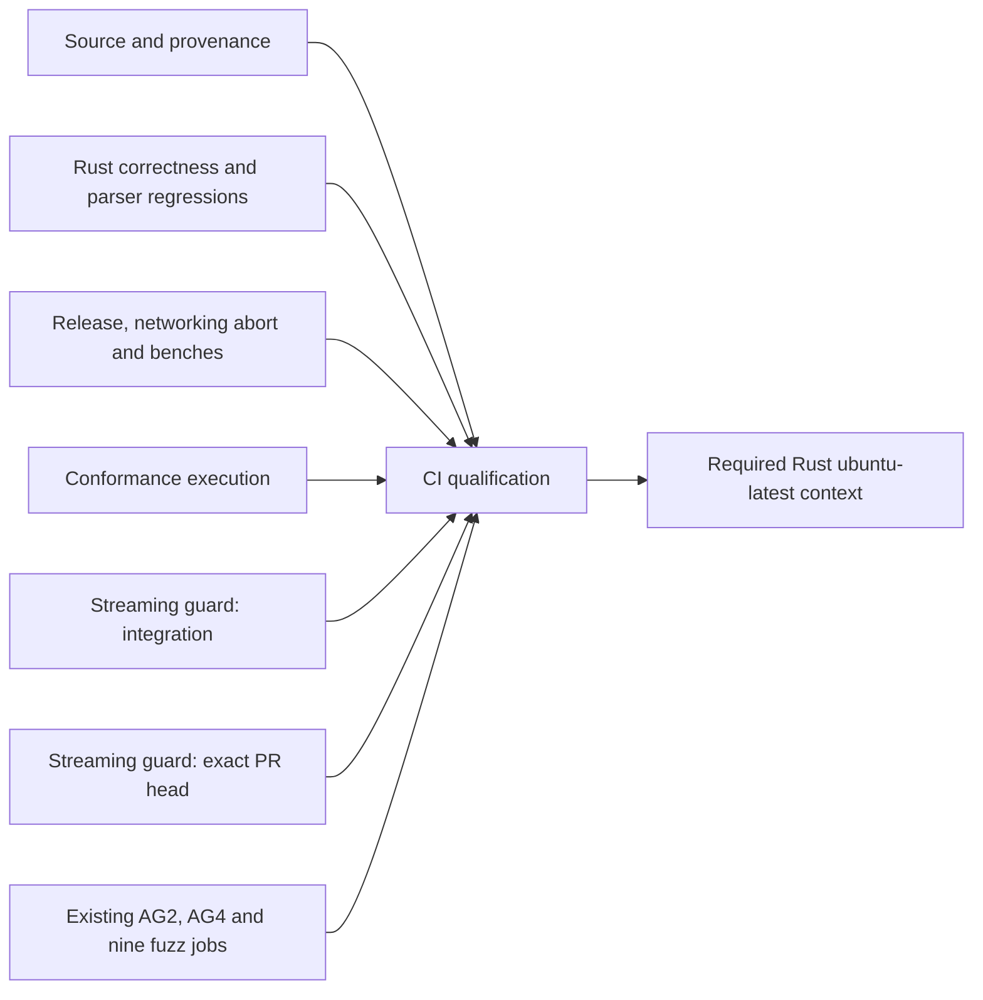

# CI critical path, parallel qualification and evidence — #1458

Status: **uncommitted parallel redesign** based on published head
`ea843be2299cc8d3d5ea15c7aab66b7abd0028ec` on
`chore/1458-optimize-ci-critical-path`. [PR #1463](https://github.com/joris97jansen/borrowser/pull/1463)
remains draft. No redesign commit, push, hosted experiment, ruleset change or
issue closure is authorized by this working-tree implementation.

This replaces the serial Rust architecture. It does not claim a measured CI
speedup: the new graph has not run on GitHub. The original two integration-tree
workspace guard executions remain enabled during replacement qualification.
The native narrower-recipe and enforcement proofs needed for removal are still
pending. No production Rust source, guard workload, assertion, instrumentation,
Cargo dependency or compiler profile changes are included.

## Observed failure and critical path

[Run 43376243486](https://github.com/joris97jansen/borrowser/actions/runs/43376243486)
executed synthetic integration commit
`c5d88fd2e3188a8b97036372f8a504b5f26615da`, whose parents were master
`144ef3bc887ac5688ac7f6b123a6e98f1e1485f2` and the published head above.
Its tree was `375de3c1a65ee3b0a197aec22500cd2ea7c5fe51`.
All original integration qualifications passed. Rust was cancelled after 45m17s;
the annotation explicitly says it exceeded 45m0s. Total workflow elapsed was
45m25s, and summed non-skipped job execution was 61m12s. Cancellation/cleanup
explains the excess over the configured deadline; it is not extra qualified time.
This failed run is not a successful performance comparison.

| Serial Rust step | Observed elapsed |
| --- | ---: |
| Full source/provenance and dependency-graph qualification | 255s (175 tests: 251.838s) |
| Clippy: ordinary / HTML5 alias / hardening | 99s / 1s / 25s |
| Debug all-target build | 449s |
| Separate package-qualified conformance binary | 158s |
| Default workspace tests | 295s, guard 220.95s |
| Explicit HTML5 workspace tests | 294s, guard 221.66s |
| Other parser conformance/golden/fatal/fuzz-regression/WPT tests | 178s |
| Release / HTML5 release builds | 206s / 2s |
| Networking release-abort qualification | 105s |
| HTML / CSS benchmark compilation | 61s / 41s |
| Exact-head isolated compilation | 462s |

The head step began at 06:42:12 UTC, 36m56s after the Rust job started, leaving
8m04s of job time. Preparation consumed about 7m43s. The correctly bound head
guard then started, but cancellation interrupted it after roughly 33 seconds.
No successful head result, post-execution source checks or cleanup completion
was emitted. The gate correctly rejected `rust: cancelled`.

AG2 passed in 397s: build/lint 58s, native ownership 66s, complete real-browser
conformance 233s. Its exact 487-MiB cache hit restored in 13s. AG4 and all nine
fuzz jobs passed. AG2 is not the observed critical-path owner and is unchanged.

[1458-parallel-evidence.json](1458-parallel-evidence.json) records immutable run
and artifact identities, job/step costs, native configurations and local probes.
The older observational baseline and unchanged-guard profile are retained below.

## Implemented job graph and ownership

All six Rust work jobs start independently. None waits for the full provenance
regression suite or another heavy build. Each first verifies the integration
commit/parents and performs the existing fast committed-input/subtree preflight.
The full provenance suite is mandatory in its own concurrent job. This preserves
preflight-before-Cargo semantics without adding a four-minute serial dependency.



| Job | Qualification owned | Deadline |
| --- | --- | ---: |
| `source_provenance` | `make check-url-dependencies`, all admitted provenance/CI tests, `make check-network-dependencies`; main and fuzz locked graphs | 10m |
| `rust_correctness` | Formatting, all three lint lanes, both debug all-target builds, both unchanged full workspace test lanes, parser conformance/external/fatal/golden/smoke/rawtext/pipeline/WPT qualifications, generated entities | 30m |
| `rust_release` | Both release workspace builds, unchanged release-abort command and its 6m bound, both benchmark-compilation commands | 20m |
| `rust_conformance` | Package-only conformance binary followed by bounded AH9/AG8 execution | 10m |
| `streaming_integration` | Full/alias/narrow artifact evidence, replacement-inventory audit, strict full-workspace guard execution on integration/push commit | 25m |
| `streaming_head` | Existing detached exact-head worktree qualification, full workspace feature unification, isolated target, source verification and cleanup; PRs only | 25m |
| `ci_qualification` | Exact prerequisite-set, result and source-receipt validation | 2m |
| `rust` | Existing required status identity, accepting only successful `ci_qualification` | 2m |

The 158-second conformance binary already has a distinct package-only feature
configuration. Moving it and its short bounded executions separates genuine
qualification ownership without changing that graph. Parser feature lanes stay
with correctness to retain their existing workspace compilation reuse. Benches
stay with release to retain eligible release dependencies. Splitting every lint,
feature lane or parser target would multiply builds without supporting evidence.

The shared checkout, source preflight, toolchain, dependencies and completion
steps use small YAML anchors in the same committed workflow. No reusable workflow,
Python production helper, local action, orchestration framework or new Makefile
target is introduced. GitHub supports these [anchors and aliases](https://docs.github.com/en/actions/reference/workflows-and-actions/reusing-workflow-configurations#yaml-anchors-and-aliases).
The existing provenance contract already binds the complete workflow and all
committed qualification tests; no provenance exception is added.

## Source and mandatory-gate contract

PR integration jobs check out `github.sha` with complete history, verify its
ordered parents against the event base/head, and verify the exact head object
exists. Master pushes qualify the actual pushed SHA without requiring merge
parents. Successful completion rechecks HEAD and a clean source checkout before
emitting `qualified_sha` and `qualified_tree`.

The head job retains the reviewed detached-worktree program. Its SHA receipt is
emitted only after guard success, head source rechecks, bounded worktree cleanup
and integration-checkout verification. The job's tree receipt comes from the
verified head object after that success. The provenance job records the expected
head tree for comparison; recording this object is not head qualification.
Forks use the base repository's synthetic merge ancestry, without fork write
credentials. Missing objects, wrong parents and dirty/mismatched sources fail.

`CI qualification` expects exactly seventeen ordinary prerequisites. It requires
success from every one on PRs. Only `streaming_head` may be skipped on master
pushes, and it must have no qualification outputs. Failed, cancelled, timed-out,
neutral, skipped, missing, unexpected and malformed results otherwise fail.
All five integration Rust source receipts must match the event integration SHA
and the provenance tree. PR head receipts must match the independently executed
head SHA and its expected tree; a head tree may legitimately differ from merge.
Unknown event types fail. Evidence is not substituted for successful execution.

The live ruleset still requires only **Rust (ubuntu-latest)**, GitHub Actions
integration 15368. The new `rust` job preserves that exact context as a final
barrier depending on `ci_qualification`, with `always()` and strict result checking.
Consequently a failed/skipped/cancelled gate cannot leave a green legacy context.
Heavy jobs have no dependency on this barrier, so there is no cycle or recreated
serial critical path. A missing workflow/check cannot satisfy the existing
required context.

This describes the local design, not already-verified hosted enforcement. After
separate publication authorization, verify the actual context identity and
failure/cancellation/skipping/missing-check paths under the real ruleset. Keep
Rust required throughout. Requiring **CI qualification** directly is an optional
subsequent administration change requiring separate authorization and enforcement
readback. No settings changes are made here, and no new job is claimed already
independently required by the live ruleset.

## Streaming equivalence and controlled replacement

The prior native Linux x86-64 run used Rust/Cargo 1.92.0, opt-level 1 with debug
assertions and overflow checks. Both full workspace lanes recorded 410 matching
compiler-artifact configurations and identical guard bytes:
`ab03f23b53a2be100647c775ec69621effe576cebb84590081105434a095768c`.
Both original guards actually passed. This is demonstrated native evidence for
those two lanes at that source, not proof of a new target recipe on future sources.

The unchanged test builds 5,000- and 20,000-fragment strings in memory, feeds
64-byte chunks through the runtime, and checks counter deltas, patch/token scaling,
batch bounds and successful terminal completion. It retains its 30-second event
timeout and has no external fixture-file or Cargo-environment lookup. Direct
execution preserves Cargo's crate working directory. `runtime_parse` explicitly
enables HTML5 and its dev dependency enables parse guards, test harness and DOM
snapshots; whole-workspace feature unification remains material to qualification.

The integration job now also compiles the exact narrower candidate:

```sh
cargo test --workspace --test perf_regression --locked --no-run   --message-format=json --timings
```

It records its package/target/profile/features configurations, tests whether they
are a subset of the qualified full graph, and compares guard bytes. A real Cargo
regression fixture demonstrates why `--workspace` matters: an unrelated member's
dev-dependency enables a guard feature in full and narrowed workspace builds,
while `-p runtime_parse` loses it and produces a different executable.
Package-scoped compilation is not used for production guard qualification.

Local macOS arm64 measurements found 392 matching full/alias configurations,
a 92-configuration narrower subset and identical guard hashes. This was an
existing-cache probe, not a cold run or native x86-64 proof. Each lane's actual
listing contained 2,957 records; adding the candidate skip removed exactly one,
leaving 2,956. Native narrower-recipe and full per-lane inventory evidence must
still be obtained from the published graph. The diagnostic wrapper's initial
post-processing typo is recorded separately; the clean repeated probe completed
both programs successfully. Neither attempt is claimed hosted qualification.

The audit runs each original lane's listing with its existing native-wrapper
exclusion, then lists with the proposed guard exclusion. Counter comparison
requires exactly the expected guard record to disappear and no other record to
change. This catches substring collisions and preserves unrelated and ignored
inventory records. The audit lists tests only; it does not execute workloads.

The additional integration execution still binds to the qualified **full**
workspace artifact, validates package `runtime_parse`, integration target
`perf_regression`, exact source path, standard libtest manifest property and
isolated job target path, and checks its hash after Cargo's workspace listing.
It also rejects stale source receipts. Target listing and execution must select
exactly one successful, non-ignored guard. Failures, zero/duplicate selection,
custom guard harnesses, ignored tests, changed artifacts and source mutations
remain fatal. The head program retains the same source/artifact/harness rules.

**No duplicate is removed in this uncommitted transition.** Both original
workspace commands remain unchanged, including both original guard executions.
The separate integration guard is temporarily additive. The narrower build is
a probe, not an unproven replacement. Unequal evidence cannot authorize skipping.
Activation remains a small reviewable implementation change within #1458:

1. Publish the reviewed parallel candidate with existing coverage intact, under
   separate commit/push authorization. Obtain complete native successful head and
   integration qualification plus the new artifact and inventory reports.
2. Verify feature/profile/instrumentation equivalence, standard-harness identity
   and unchanged assertions for each source context where a narrower recipe is
   proposed. Retain full compilation wherever equivalence is unproven.
3. Verify new-job failure, cancellation, skipped and missing conditions prevent a
   successful legacy required Rust check under actual GitHub enforcement.
4. Only then add the explicit guard skip to the two workspace execution commands,
   retain their complete other inventories, and require independent integration
   and exact-head success through both gates. Make full/alias configuration and
   guard-byte equivalence a fail-closed prerequisite on every run before activating
   the skips. If narrowing is activated, require its source-context feature/profile
   and artifact proof as well. A prior run's equality cannot exempt changed inputs.
   Re-run native inventory comparisons.
5. Re-measure the fully qualified graph. Do not call a failed run successful or
   close the issue merely because the graph is now parallel.

No rollout variable, dormant bypass, ignored test, permissive fallback or
nightly-only demotion is introduced. The independent parser scalability finding
below remains separate and is not concealed by these job boundaries.

## Cargo caching, compilation and timeout bounds

The failed Rust run restored no cache; the action step took 10s and post-save
was skipped on cancellation. Its key was
`v0-rust-rust-Linux-x64-71ae6766-b3b62931`. The toolchain action explicitly updated
unused stable 1.99.1 to 1.100.0. The cache action hashes all installed compilers,
so both 1.100.0 and the actually used 1.92.0 appeared in its environment hash.
This explains a concrete invalidation source; it does not prove all misses have
that cause. AG2's exact cache hit used `cba24ba9-b3b62931` instead.

The shared installer now explicitly requests the repository's 1.92.0. A regression
checks that the input matches `rust-toolchain.toml`. Disposable Cargo test
workspaces now carry the same pin and test their actual compiler version;
previous fixtures could inherit the action's unpinned stable default. Production
main/guard compilation was already pinned to 1.92.0; no version upgrade occurs.
Other preinstalled toolchains still contribute to the cache action's hash, so
runner-image changes can still invalidate caches. No broad toolchain deletion or
cache-key safety check is introduced or disabled.

Each work job uses `v1-ci-1458` plus the action's job ID, compiler/environment and
locked manifest hashes, and a distinct key: `provenance-registry`,
`workspace-debug`, `release-abort-benches`, `conformance-package`,
`streaming-integration-debug`, or `head-registry`. The provenance and head caches
are registry-only. The head build remains in its own runner-temporary target
and does not restore integration binaries. All other targets belong to separate
runner checkouts. There is no shared mutable directory, shared-key target cache,
cross-job binary artifact transfer or unverified binary reuse.

Workspace crates remain excluded; changing that policy needs measured size,
restore/save and invalidation results. Cache-on-failure remains false. Successful
parallel jobs may now save their own caches even if another job fails, unlike the
cancelled monolith. PR caches stay scoped to the PR merge ref and cannot be
promoted to master or sibling PRs under GitHub's [cache access restrictions](https://docs.github.com/en/actions/reference/workflows-and-actions/dependency-caching#restrictions-for-accessing-a-cache).
No `pull_request_target`, privileged cache promotion or sccache is introduced.
Ordinary Cargo caching has a concrete diagnosed issue and no repeated evidence
justifying additional infrastructure.

Direct builds and guard compilation now emit Cargo HTML timing reports using
`--timings`. Compiler profiles, feature selection, locking and test arguments are
unchanged. Timing reports are uploaded per job together with streaming evidence.
They allow dependency/workspace compile costs and debug/release reuse to be
inspected separately. Cache logs retain exact/fallback/miss and restore/save
classification. New namespaces, saved sizes and new cold costs are not yet measured
on GitHub; they must not be invented from local timings.

The head step retains its existing 20m outer limit and 10m preparation, 8m
execution and 30s cleanup limits, each with 10s kill grace. Its new independent
25m job funds setup and post-steps without consuming an already-spent 45m job.
Integration collection has 10m, inventory audit 3m and guard execution 8m within
its independent 25m job. Correctness's 30m bound is based on about 22m24s of
observed command costs plus setup and variability. Release's observed commands
sum to 6m55s; its 20m ceiling allows independent cold compilation and preserves
the existing abort bound. Conformance's package build and executions total about
2m40s under a 10m job; provenance's observed 4m15s suite has a 10m job. These are
provisional job-specific limits pending native cold validation, not qualified
worst-case capacity estimates. No existing failure handling or test inter-event
timeout is weakened.

## Performance objectives and cost decision

Parallel scheduling is selected because the approved direction requires it and
the serial source-qualified control exceeded its deadline. This is no longer a
proposal to preserve the monolith while considering theoretical alternatives.
The fully qualified graph still needs measured optimization acceptance.

Summing already observed command times by the new owners puts correctness at
about 22m24s before its new setup/cache costs; source provenance is about 4m16s,
release/benches 6m55s and package conformance 2m40s. A scheduling-only projection
is roughly 23–25m queue-free while original guards remain, with substantial
uncertainty from independent cold compilation and runner variability. It is not
a measured PR speedup. The additive integration job contributes another full
workspace compile and guard, so transition runner consumption can exceed the old
10% guardrail. The cancelled 61m12s run is not an equal-coverage successful cost
baseline: its head guard did not finish.

Once verified replacement is activated, removing the two workspace executions
would subtract about 7m23s from correctness at this run's guard speed. That puts
its observed command sum around 15m before setup, with warm compiler reuse still
to measure. The 15-minute warm critical-path objective is ambitious, not an
acceptance excuse or guaranteed result. Narrower compilation may reduce guard-job
cost only after its feature/artifact proof is qualified.

Latency is now the explicit priority over an automatic 10% runner-cost veto, but
no new acceptable cost percentage is silently chosen. Report the old guardrail,
actual extra runner time and the latency benefit for review before accepting the
final tradeoff. All restructuring, measurement, cache and gate work remains in
#1458; no implementation-phase issues are proposed.

For each viable parallel recipe, retain at least three exact-cache and two cold
samples, with fallback samples separately labelled. Use identical engine/test
sources, pins, profiles, workloads and head/integration coverage. Cold means fresh
job-local Cargo and target directories without restore; an incidental cache miss
is not automatically a controlled cold run. Interleave samples and record runner
image/CPU, action revisions, locks, artifact identities and cache sizes. Report
individual observations, median and range. Measure event-to-final-required-check
wall time, queue-free completion, longest work job and summed runner execution
separately, including setup, post-steps, cache operations and both gates. Cancelled
or early-failing attempts remain recorded and cannot establish an improvement.

## Four-level validation and closeability

1. **Targeted:** execute the actual workflow programs through the existing real
   Git/Cargo/libtest fixtures. Cover both color modes, the job graph and legacy
   barrier, push/PR source receipts, fork objects, exact selection, harness/target
   substitution, errors, cancellation/deadlines, inventory collisions, and Cargo
   feature unification. No new test runner or generalized framework is added.
2. **Subsystem:** run the complete qualification test module on macOS and offline
   Linux arm64, both color modes; parse expanded YAML, lint Actions expressions,
   check Bash syntax, Rust formatting, source/command conservation and diffs.
   Native x86-64 graph/cold/performance validation remains hosted work.
3. **Runtime smoke:** unnecessary for tooling-only edits. Preserve existing AG2
   and release-abort runtime qualifications on supported native runners.
4. **Full CI:** `make check-url-dependencies` and `make ci` must retain their
   committed-input preflight. The uncommitted workflow/test candidate cannot pass
   that preflight, and no bypass is permitted. After authorized publication,
   require successful native full CI, source qualification and failure-path
   enforcement before activation or closure.

Commands for the local test matrix:

```sh
CARGO_TERM_COLOR=always python3 -I -B tools/ci/tests/test_ci_qualification.py
CARGO_TERM_COLOR=never python3 -I -B tools/ci/tests/test_ci_qualification.py
make fmt-check
make check-url-dependencies
make ci
git diff HEAD --check
```

The earlier 36 regressions are retained and extended for the new ownership and
source graph. All 58 tests passed with `CARGO_TERM_COLOR=always` and `never` on
macOS arm64 (50.172s / 50.200s) and offline Linux arm64 (12.345s / 12.644s), using
Rust/Cargo 1.92.0. Rust formatting, Actionlint 1.7.12, expanded YAML, all 96 Bash
run blocks and diff checks passed; ShellCheck was not run. Both provenance
commands exited 2 at the expected uncommitted-test preflight, before full CI.
Exact commands, logs and remaining native limits are recorded in the structured
parallel evidence. Existing original qualification commands are
checked against immutable master `144ef3bc`, allowing only reporting-only
`--timings` additions. AG2, AG4 and fuzz job bodies remain unchanged.

**Verdict: Not closeable yet.** The parallel candidate is reviewable locally,
but successful native head execution, hosted gate enforcement, qualified guard
replacement, repeated cold/warm timings and an accepted latency/runner-cost
tradeoff are outstanding. There are no browser-engine ownership changes or
feature-gap status changes. `docs/engine-feature-gap-tracker.md` remains unchanged.
No shortcut, production parser fix, weakened assertion or coverage removal is
used to claim success.

## Retained historical measurements and independent engine finding

The following observations preserve the baseline and engine profile. They do
not describe the new job graph or substitute for its hosted qualification.

## Refreshed observational baseline

Collected on 2026-11-12 using GitHub's run/job APIs and decoded job logs.
[1458-baseline.json](1458-baseline.json) preserves all returned job and step
timestamps, durations, available cache excerpts and guard excerpts. Its
`head_sha` is the run API's field, not independent proof of a PR-head execution.

| Run | Revision | Rust | Workflow elapsed | Sum of job execution | Rust cache |
| --- | --- | --- | --- | --- | --- |
| [42522258228](https://github.com/joris97jansen/borrowser/actions/runs/42522258228) | `4012cb42` PR run API head | 24m01s | 24m05s | 38m30s | fallback, 968 MiB |
| [42568144045](https://github.com/joris97jansen/borrowser/actions/runs/42568144045) | `4a997e93` master push | 24m17s | 24m21s | 40m39s | fallback, 968 MiB |
| [43188478801](https://github.com/joris97jansen/borrowser/actions/runs/43188478801) | `a382f604` master push | 35m36s | 35m40s | 53m18s | fallback, 1088 MiB |
| [43239794456](https://github.com/joris97jansen/borrowser/actions/runs/43239794456) | `144ef3bc` master push | 26m49s | 26m53s | 42m03s | exact hit, 1081 MiB |

These are different revisions with different qualification/setup behavior. They
are not a controlled cold/warm comparison, repeated runs at one revision, or
evidence that #1458 has improved CI. No cold-cache baseline is available yet.
Workflow elapsed includes queue/startup/completion overhead; summed job time
excludes queue delay and billing rounding. Both are merge/push-only baselines
without independently executed PR heads.

Latest master Rust step breakdown:

| Step | Elapsed |
| --- | --- |
| Cargo cache restore | 28s |
| URL sources, graphs and provenance regression qualification | 225s |
| Debug all-target build | 244s |
| Package-only conformance build | 61s |
| Default workspace tests | 282s, including 210.90s guard |
| Explicit HTML5 workspace tests | 280s, including 209.97s guard |
| Release workspace build | 104s |
| Feature-qualified release-abort qualification | 59s |

The URL step's actual graph checks took about two seconds; the regression suite
accounts for most of the remaining time. Those provenance/history tests remain
required. No cache or scheduling change is justified merely by their duration.

Latest master AG2 took 6m48s: runtime packages 5s, reference installation 4s,
Cargo cache 12s, build/lint 63s, native qualification 67s, complete conformance
242s, artifact upload 1s. It is not the observed critical path. Keep its pinned
browser, native ownership, sandbox, cleanup and complete real-browser coverage.

The original comparison workflow remains available at the immutable source
revision referenced by the original run; the refreshed comparison workflow is
[ci.yml at 144ef3bc](https://github.com/joris97jansen/borrowser/blob/144ef3bc887ac5688ac7f6b123a6e98f1e1485f2/.github/workflows/ci.yml).

### Re-fetching the raw timing evidence

```sh
gh api repos/joris97jansen/borrowser/actions/runs/43239794456
gh api 'repos/joris97jansen/borrowser/actions/runs/43239794456/jobs?per_page=100'
gh api repos/joris97jansen/borrowser/actions/jobs/131256790892/logs > rust.log
```

For each job or step, subtract `started_at` from `completed_at`. Sum job
execution, including cache post-steps, separately from event-to-final-check
latency. Retain run attempt and all failures/cancellations; do not select only
fast successful runs.

## Unchanged guard profiling

Supporting local evidence is macOS arm64 with Rust/Cargo 1.92.0 and the existing
development profile (`opt-level=1`, debug assertions and overflow checks enabled).
It does not establish native Linux x86-64 equivalence or hosted performance.
Structured local results are in [1458-local-evidence.json](1458-local-evidence.json);
the [profile excerpt](1458-profile-sample.txt) preserves the observed worker path.

The guard source SHA-256 is
`d94155270a625f8441fc4500b534825b8648f979389eb4c20b49e626c669487a`.
Its workload, assertions, instrumentation and behavior are unchanged.

The full default workspace test build completed in 65.222s against an existing
local dependency/build cache; it was not a cold build. The explicit HTML5
no-run invocation took 1.353s and reported the guard fresh. Both contained 392
identical compiler-artifact configuration records and the same guard bytes:
`eb942f8885bf88a6d805088c48b0a535cc8c5b08505dc95bf2a347297438edfa`.

`cargo test --workspace --test perf_regression --locked --offline --no-run
--message-format=json` also reused those guard bytes locally (3.708s invocation).
This is supporting evidence for a narrower target recipe, not proof of its cold
compilation cost or native Linux equivalence. A plain `-p runtime_parse` remains
unqualified: its feature graph differs, including `html/parser-conformance`.

The unchanged guard passed in 133.71s in the sampled run. A ten-second sample
contained 8,463 worker-thread observations, with 7,623 (90.1% of that window)
under `assert_invariants`' parent child-list `filter().count()` loop. The test
thread was predominantly waiting for events. This is a sample-window finding,
not a claim that 90.1% of the whole run or Linux runtime has been attributed.

The concrete path is:

```text
runtime_parse::driver::handle_runtime_chunk
  RuntimeState::drain_patches
    HtmlParser::take_patches
      HtmlParser::apply_patches
        PatchValidationArena::apply_batch_trusted
          PatchValidationArena::assert_invariants
            parent_node.children.iter().filter(...).count()
```

`validate.rs:141–145` scans a parent's whole child list for each child. A wide
parent therefore introduces quadratic sibling-reference counting per audit;
auditing the growing arena after fixed-size drains compounds that work. This
is production parser validation, not fixture-string construction or a sleep.
The trusted runtime path does not clone the arena transactionally. Full phase
attribution, including allocation, finalization and Linux profiling, remains
pending. No validation is bypassed or reduced to conceal this finding.

An additional unprofiled test passed in 134.81s, but `/usr/bin/time -l` returned
1 because the sandbox denied `sysctl kern.clockrate`. That wrapper result is
not recorded as a successful measurement command or a parser-test failure.
An independent invocation using Python's child-process resource accounting
passed: 131.82s reported by libtest, 131.860s wall, 131.424s user and 0.196s system.
These uncontrolled local observations do not satisfy the hosted comparison criteria.
Local raw artifacts are under `/private/tmp/borrowser-1458-evidence`; the sample
SHA-256 is `dabc14bfe89f0b1e3bccb69b451ecbf4b62e54c8c61ec17094e69a050216d91d`.

### Reproduction

Run the exact workspace compilation configurations; do not substitute release,
alter compiler profiles, disable instrumentation or reduce inputs:

```sh
CARGO_INCREMENTAL=0 cargo test --workspace --lib --bins --tests --examples \
  --locked --offline --no-run --message-format=json --timings -vv > default.jsonl
CARGO_INCREMENTAL=0 cargo test --workspace --lib --bins --tests --examples \
  --features html5 --locked --offline --no-run --message-format=json --timings -vv > html5.jsonl
```

Cargo's verbose build-script diagnostics can appear alongside JSON; identify
`compiler-artifact` JSON records. Obtain the `runtime_parse` `perf_regression`
test executable from its artifact, hash it immediately after each build, then
run it from `crates/runtime_parse` with
`runtime_parse_linear_streaming_guard --exact --nocapture`. Sample that process,
including the runtime worker, with macOS `sample PID 10 1 -mayDie -file profile.txt`
or an available native Linux CPU profiler. Sampling is diagnostic; compare
unmodified, unprofiled runs for performance decisions.

## Proposed independent parser defect

No GitHub issue has been created and no milestone setting changed.

This evidence and proposal belong here rather than in
`docs/engine-feature-gap-tracker.md`, whose documented purpose is a small
checklist of visible browser/CSS feature gaps. Profiling an existing validation
path does not change feature support or conformance status. The review removes
the candidate's tracker entry while preserving the complete finding below.

Milestone proposal: existing **Milestone AU — Real-World Static Page
Compatibility, Quirks, Resilience, and Production Hardening** (#107). The original
HTML/parser foundation milestones are closed; this is an unresolved production
scalability finding, not a reason to claim their conformance work is undone.

Title: **Bound repeated sibling-reference scans in streaming HTML patch validation**.

Description: the unchanged streaming guard at `144ef3bc` spends most of the
recorded macOS worker sample in the full parent-child reference count in
`PatchValidationArena::assert_invariants`. Repeated audits of a wide, growing
arena impose superlinear validation work even though emitted token/patch counts
meet the current guard. Include the exact source/binary identities, workload,
sample counts and reproduction above; obtain native Linux attribution as well.
Investigate preserving duplicate-reference detection, parent consistency,
template ownership, reachability, acyclicity, transactional public application
and terminal trusted-session failure while bounding validation work. Add stable
work-count regression coverage and retain semantic/failure tests. Do not fix
this defect by reducing fixture size, dropping audits or changing CI profiles.
